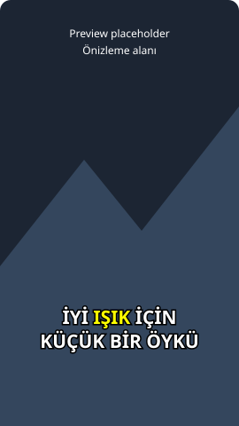

# altyazi-tr

altyazi-tr, kısa dikey videolar için faster-whisper kullanarak çevrimdışı ve kelime zamanlı Türkçe altyazı üretir.

[](.github/workflows/ci.yml)
[](LICENSE)

[English](README.md)

CLI, bilgisayarınızdaki video veya ses dosyasından SRT, WebVTT ya da stilli ASS
oluşturur. Türkçe büyük harf dönüşümünü, kısa satırları, duraklamaları ve okuma
süresini gözetir. Ses ve metin bilgisayarınızda kalır; API hesabı veya ücretli
servis gerekmez. CI rozeti iş akışına bağlantıdır; sunucuda testlerin geçtiğini
iddia etmez. GitHub deposu açıldığında canlı Actions rozetiyle değiştirilebilir.

## Kurulum

Python 3.10 veya üstü gerekir. Depoyu bilgisayarınıza aldıktan sonra:

```sh
python -m venv .venv
# Linux / macOS:
. .venv/bin/activate
# Windows PowerShell için bunun yerine:
# .venv\Scripts\Activate.ps1
python -m pip install .
```

`faster-whisper` ana bağımlılıktır. İsteğe bağlı ekler:

```sh
python -m pip install ".[ffmpeg,yaml]"
```

ffmpeg **yalnız `--burn` ile videoya gömmek için** gerekir. Ses tanıma,
faster-whisper'ın PyAV çözücüsünü kullanır; ffmpeg çalıştırılabilir dosyasına
ihtiyaç duymaz. Gömme işleminde ffmpeg şu sırayla aranır:

1. `PATH` üzerindeki `ffmpeg`.
2. `ffmpeg` ekiyle kurulan `imageio_ffmpeg.get_ffmpeg_exe()`. Bu paket,
   `IMAGEIO_FFMPEG_EXE` değişkenini ve kendi dosya seçme kurallarını kullanabilir.

Seçilen ffmpeg'de `ass`/libass, `libx264` ve AAC desteği bulunmalıdır. Bazı hazır
derlemelerde libass yoktur; gömme başarısızsa uygun bir sistem derlemesi kurun.
Stilde seçtiğiniz yazı tipi de bilgisayarınızda bulunmalı; eksik font satırların
görünümünü değiştirebilir.

### Yerel modeller ve çevrimdışı kullanım

Paketlerin kurulması ve modelin ilk kez alınması internet gerektirir. Bu CLI,
**ilk kullanımda bile model indirmez**; tanıma katmanı her zaman
`local_files_only=True` kullanır. `small` gibi bir ad kullanacaksanız model,
Hugging Face önbelleğinde önceden bulunmalıdır. Alternatif olarak tokenizer
dosyalarını da içeren eksiksiz bir faster-whisper/CTranslate2 model klasörü
verebilirsiniz. Ham OpenAI checkpoint dosyası, dönüştürülmüş model klasörünün
yerini tutmaz.

Modeli internet bağlantısı olan bir bilgisayarda
[ana projenin model yönergeleriyle](https://github.com/SYSTRAN/faster-whisper#model-conversion)
ayrıca edinin ve klasörün tamamını çevrimdışı bilgisayara taşıyın. Modeli indirirken
kayıtlarınızı hiçbir yere yüklemeyin. `--model ./models/small` kullanıcı önbelleğine
bağımlılığı kaldırır. Model eksikse hata verilir; ses, metin ve rapor herhangi
bir servise gönderilmez. Model ve medya dosyaları Git dışında tutulur.

### CPU, GPU ve Windows

`--device auto`, CTranslate2 GPU bildirirse CUDA'yı seçer; aksi halde CPU üzerinde
`int8` kullanır. Otomatik seçilen CUDA ile tanıma çalışma zamanı hatası verirse
CPU int8 ile yeniden denenir. `--device cpu` GPU bağımlılıklarından kaçınmayı
sağlar. `--compute-type`, normal varsayılanı değiştirir: CPU'da `int8`, CUDA'da
`float16`. Otomatik CUDA'dan CPU'ya dönüşte yine int8 kullanılır. Açıkça verilen
`--device cuda` seçeneğinde hatalar gizlenmez.

GPU için uyumlu NVIDIA sürücüsü, CUDA ve cuDNN kurulumu gerekir;
[ana projenin GPU gereksinimlerini](https://github.com/SYSTRAN/faster-whisper#gpu)
kontrol edin. Gereksinimler CTranslate2 sürümüne göre değişebilir. Bu paketi kurmak,
GPU ortamının hazır olduğu anlamına gelmez. Windows'ta yerel bağımlılıkları için
hazır wheel bulunan bir Python sürümü ve mimari kullanın. Gerekirse uygun ffmpeg'yi
`PATH`'e ekleyin, boşluk içeren yolları tırnak içine alın. DejaVu Sans yoksa stilde
`Arial` gibi kurulu bir font seçin. Çıktılar UTF-8'dir.

## Hızlı başlangıç

Önceden edinilmiş yerel modelle:

```sh
altyazi-tr invented-clip.mp4 --model ./models/small -o captions --format all
altyazi-tr invented-clip.mp4 --model ./models/small -o karaoke --format ass --mode words --upper --report json
altyazi-tr invented-clip.mp4 --model ./models/small -o rendered --format ass --burn --style docs/style.json --position middle
```

Dosya adları örnektir; depoda kayıt bulunmaz. Varsayılan dil `tr`'dir. Desteklenen
başka bir dil için örneğin `--lang en` kullanın ve çok dilli model seçin. Büyük harf
dönüşümü isteğe bağlıdır (`--upper`). Noktalı/noktasız I ayrımı yalnız `--lang tr`
ve `az` için uygulanır; diğer dillerde düz büyük harf kullanılır.

`-o`, uzantısız çıktı adı veya altyazı dosyası adı alır. `-o clip.v1.srt --format all`,
`clip.v1.srt`, `clip.v1.vtt` ve `clip.v1.ass` üretir. `-o` verilmezse girdi dosyasının
uzantısız adı kullanılır. Üst klasörler oluşturulur; mevcut çıktının üzerine
yazılmaz. `--burn`, gerekiyorsa ASS dosyasını da oluşturur ve
`<ad>.burned.mp4` üretir. H.264/AAC kullanır ve video akışı gerektirir. Gömme işlemi
başarısız olursa önceden yazılmış altyazı ve rapor dosyaları kalır.

`groups`, her altyazı bloğunda bir kelime grubu gösterir. `words`, kelime başına
bir blokla başlar; okuma süresi için kısa komşu bloklar birleşebilir. ASS çıktısında
`words` kipi, o anda söylenen kelimeyi vurgular; aradaki sessizlikte vurgu kaldırılır. SRT/VTT
sabit metindir, bu renk hareketini taşımaz. Düz altyazıda kelimeleri olabildiğince
ayrı tutmak için `--min-duration 0.01 --max-cps 10000` kullanabilirsiniz.



Gerçek GIF veya ekran görüntüsü için [docs klasöründe](docs/README.md) yer ayrıldı.

## Yerleşim ve görünüm

Varsayılanlar: satır başına 18 karakter, ekranda en fazla 2 satır, 0,6 saniye
duraklama eşiği, en az 0,8 saniye gösterim ve saniyede en fazla 18 karakter.
Boşluk ve noktalama, uzunluğa ve okuma hızına dahildir. Genişlik, fontun piksel
ölçümüyle değil karakter sayısıyla hesaplanır. `--max-lines` 1–4 satırı destekler.

Noktalama ve duraklamalar bölme noktalarıdır. Satır seçimi, yer varsa `ve`, `ama`,
`ki` ve ayrı yazılan `de`/`da` bağlaçlarını satır sonunda bırakmaz. Kısa komşu
bloklar, sığıyorsa ve arada uzun duraklama yoksa birleşir. Gösterim süresi sessiz
aralığa uzatılabilir; sonraki bloğun başlangıcını veya medyanın sonunu aşmaz.
Bloklar birbiriyle çakışmaz.

Bazı koşullar aynı anda sağlanamaz: tek başına uzun bir kelime korunur; hızlı
konuşma, hedef okuma hızını aşabilir. Genişlik veya hız sınırı için metin sessizce
silinmez. CLI uyarı verir; `--report json`, `long_word`, `short_duration`,
`reading_speed` ve `trailing_conjunction` bildirimlerini listeler. Raporda ayrıca
`--confidence` eşiğinin (varsayılan 0,6) altındaki kelimeler; özgün metinleri,
olasılıkları ve zamanlarıyla bulunur. Olasılıklar model tahminidir; ölçülmüş
doğruluk puanı değildir. Yerel rapor hassas konuşma metni içerebilir; kaydın
kendisi kadar özenle saklayın.

ASS, 1080×1920 referans tuvali, kalın yazı, kontur ve alttan 320 piksel boşlukla
alt hizalama kullanır. Konumlar `bottom`, `middle` ve `upper`'dır; `--position`,
stil dosyasındaki konumu geçersiz kılar. ASS kurallarına göre orta hizalamada dikey
boşluk etkisizdir; üst hizalamada üst kenardan ölçülür. Başka en boy oranları için
stili uyarlayın. JSON ek bağımlılık istemez; YAML için `[yaml]` gerekir ve güvenli
okuyucu kullanılır. [JSON](docs/style.json) ve [YAML](docs/style.yaml) örneklerine
bakın. Alanlar: `font`, `font_size` (1–300), `primary_color`, `highlight_color`,
`outline_color`, `outline` (0–20), `bold`, `position`, `margin_v` (0–900).
Renkler ASS `&HAABBGGRR` biçimindedir: saydamlık, mavi, yeşil, kırmızı. Bilinmeyen
alanlar reddedilir.

## API özeti

```python
from altyazi_tr import LayoutConfig, Word, layout
from altyazi_tr.writers import ass, srt, vtt

# Tamamen uydurma cümle; model gerekmez.
words = [Word(0.0, 0.4, "iyi", 0.95), Word(0.5, 1.0, "ışık", 0.90)]
cues = layout(words, LayoutConfig(upper=True), duration=2.0)
print(srt(cues))
animated = ass(cues, karaoke=True)
web_subtitles = vtt(cues)
```

| Giriş noktası | İşlev |
| --- | --- |
| `Word(start, end, text, prob)` | Doğrulanan, değişmez kelime; zaman saniye, olasılık 0–1 |
| `Cue(start, end, lines)` | Değişmez altyazı bloğu; satırlar `Word` demetlerinden oluşur |
| `layout(words, config, duration=None)` | Saf yerleşim; sırayı korur, çakışan kelimeleri reddeder |
| `turkish_upper(text)` | Önce `i→İ`, `ı→I`, sonra Unicode büyük harf dönüşümü |
| `layout_warnings(cues, config)` | Sağlanamayan koşulları bildirir |
| `transcribe.transcribe(path, ...)` | Model, aygıt, hesap türü, dil ve VAD ayarlı yerel tanıma |
| `style.load_style(path)` | Doğrulanan JSON/YAML ASS stili |
| `writers.srt/vtt/ass(cues)` | Metin döndürür; dosyaya yazmayı çağıran yönetir |
| `burn.burn(source, subtitles, output)` | ASS dosyasını yerel ffmpeg ile gömer; üzerine yazmaz |

`layout_warnings` fonksiyonunu doğrudan `altyazi_tr.layout` modülünden içe aktarın.
Paketi içe aktarmak, tanıma kütüphanelerini veya modeli yüklemez. Tanıma katmanı
boş ve sıfır süreli kelimeleri atlar, birden fazla kelime içeren parçaların süresini
orantılı dağıtır; çakışan aralığın başlangıcını önceki kelimenin sonuna çeker.
Saf API, önceden doğrulanmış ve zaman sırasındaki kelimeleri kabul eder. Son
kelimeden sonra süre eklenmesini istemiyorsanız `duration` vermeyin. Hatalar
İngilizcedir; CLI başarıda 0, işlem hatasında 1, argüman hatasında 2 döndürür.

## Model seçimi ve sınırlar

Aşağıdaki ölçekler yaklaşık değerlerdir; bu projede yapılmış ölçümler değildir:

| Çok dilli model | Yaklaşık parametre | Göreli hız | Beklenen doğruluk farkı |
| --- | ---: | --- | --- |
| tiny | 39M | En hızlı | Türkçede daha çok tanıma hatası |
| base | 74M | Hızlı | Taslak için kullanılabilir |
| small (varsayılan) | 244M | Orta | Başlangıç için makul seçim |
| medium | 769M | Daha yavaş | Zorlu konuşmada çoğunlukla daha iyi |
| large-v3 | 1.550M | Bu listedeki en yavaş | Çoğunlukla en güçlü; daha fazla bellek ister |

Hız, bellek ve doğruluk; donanıma, hesap türüne, gürültüye, konuşmaya ve dile göre
değişir. Tablo genel beklentiyi gösterir; Türkçe başarım testi veya garanti değildir.
[Ana projenin model listesine](https://github.com/openai/whisper#available-models-and-languages)
bakabilirsiniz. Konuşmacı ayrımı, çeviri, zorunlu hizalama ve videoyu yeniden
kadrajlama yoktur. Müzik, üst üste konuşma, sessizlik ve noktalama; hatalara veya
olmayan sözlerin üretilmesine yol açabilir. Yayınlamadan önce metni ve zamanlamayı
kontrol edin. SRT/VTT, ASS stillerini korumaz. ASS zamanları saniyenin yüzde biri
hassasiyetindedir; daha kısa olaylar yuvarlamada kaybolabilir. Girdi medyasının
üzerine yazılmaz. Paket kodu ağ çağrısı yapmaz; kurulum ve dışarıdan model edinme
ayrı çevrim içi adımlardır.

## Katkı

Kurulum, çevrimdışı testler, lint/tip denetimleri ve commit öncesi sır taraması
için [CONTRIBUTING.md](CONTRIBUTING.md) dosyasına bakın. CI; Linux ve Windows'ta
Python 3.10 ve 3.12 ile modelsiz çalışır. `python -m pytest -m slow`, isteğe bağlı
yerel model testini seçer. Depoda model veya gerçek kayıt yoktur. Örnekleri yapay
tutun; iki README aynı bilgiyi taşısın. Lisans: [MIT](LICENSE).
