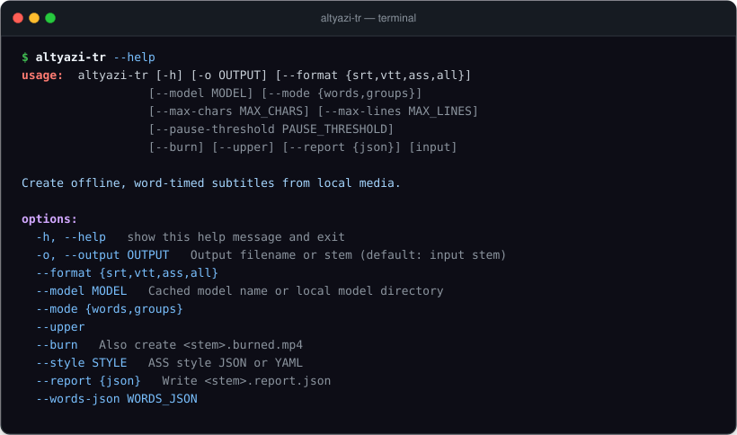

# altyazi-tr

Kısa dikey videolar için faster-whisper kullanarak çevrimdışı ve kelime zamanlı Türkçe altyazı üretimi.

[](https://github.com/YusufBeratZengin/altyazi-tr/actions/workflows/ci.yml)
[](https://pypi.org/project/altyazi-tr/)
[](https://www.python.org/)
[](LICENSE)

[English](README.md)



## Neden altyazi-tr?

- **%100 Çevrimdışı ve Gizli**: Dış API çağrısı, telemetri veya otomatik model indirme yoktur. Ses kayıtlarınız, videolarınız ve altyazı metinleriniz tamamen bilgisayarınızda kalır.
- **Dikey Videolara (9:16) Özel Tasarım**: Shorts, Reels ve TikTok için dar satır uzunlukları (18 karakter), duraklama duyarlı satır bölme ve stilli ASS altyazılarda renkli karaoke kelime animasyonları.
- **Doğal Türkçe Dil Kuralları**: Noktalı ve noktasız I (`i→İ`, `ı→I`) ayrımını doğru yapan büyük harf çevrimi, satır sonunda yalnız kalan bağlaçları (`ve`, `ama`, `ki`, `de`/`da`) önleme ve düşük güvenli kelime uyarı raporları.

---

## Hızlı başlangıç

### 1. Kurulum

Python 3.10 veya üstü gerekir.

```sh
# Sanal ortam oluşturun ve etkinleştirin
python -m venv .venv

# Linux / macOS:
source .venv/bin/activate
# Windows PowerShell:
# .venv\Scripts\Activate.ps1

# Temel paketi kurun
python -m pip install altyazi-tr

# Veya depodan video gömme ve YAML desteğiyle kurun:
python -m pip install ".[ffmpeg,yaml]"
```

Kurulumu doğrulayın:

```sh
altyazi-tr --help
```

### 2. Kopyala-çalıştır doğrulanmış demo

Önceden kaydedilmiş örnek kelimelerle altyazı üretimini hemen deneyin (model indirme gerekmez):

```sh
altyazi-tr --words-json docs/examples/sample.words.json -o captions --format all --mode words --upper
```

Bu komut geçerli klasörde `captions.srt`, `captions.vtt` ve `captions.ass` dosyalarını oluşturur.

### 3. Yerel videodan altyazı üretimi

Önceden indirilmiş bir faster-whisper modeliyle (örneğin yerel önbellekteki veya klasördeki `small` modeli):

```sh
altyazi-tr video.mp4 --model ./models/small -o captions --format all
```

---

## Kullanım örnekleri

### Standart Altyazılar (SRT ve WebVTT)

```sh
altyazi-tr video.mp4 --model ./models/small -o captions --format srt
altyazi-tr video.mp4 --model ./models/small -o captions --format vtt
```

Kısaltılmış SRT örneği ([`docs/examples/sample.srt`](docs/examples/sample.srt)):

```srt
1
00:00:00,000 --> 00:00:02,050
BUGÜN DİKEY
VİDEOLAR İÇİN

2
00:00:02,120 --> 00:00:04,100
ALTYAZI
HAZIRLIYORUZ ÇÜNKÜ

3
00:00:04,180 --> 00:00:07,100
İYİ IŞIK VE NET
SES ÇOK ÖNEMLİ.
```

### Karaoke Kelime Vurgulu ASS Altyazıları

`words` kipi konuşulan kelimeyi anlık olarak vurgular, aradaki sessizliklerde vurguyu kaldırır:

```sh
altyazi-tr video.mp4 --model ./models/small -o karaoke --format ass --mode words --upper --report json
```

Karaoke ASS örneği ([`docs/examples/sample.ass`](docs/examples/sample.ass)):

```ass
Dialogue: 0,0:00:00.00,0:00:00.42,Default,,0,0,0,,{\1c&H00FFFF&\1a&H00&}BUGÜN{\rDefault} DİKEY\NVİDEOLAR İÇİN
Dialogue: 0,0:00:00.42,0:00:00.48,Default,,0,0,0,,BUGÜN DİKEY\NVİDEOLAR İÇİN
Dialogue: 0,0:00:00.48,0:00:00.95,Default,,0,0,0,,BUGÜN {\1c&H00FFFF&\1a&H00&}DİKEY{\rDefault}\NVİDEOLAR İÇİN
Dialogue: 0,0:00:00.95,0:00:01.02,Default,,0,0,0,,BUGÜN DİKEY\NVİDEOLAR İÇİN
Dialogue: 0,0:00:01.02,0:00:01.60,Default,,0,0,0,,BUGÜN DİKEY\N{\1c&H00FFFF&\1a&H00&}VİDEOLAR{\rDefault} İÇİN
```

### Videoya Altyazı Gömme (`--burn`)

Stilli ASS altyazısını yerel ffmpeg kullanarak doğrudan videoya işleyin:

```sh
altyazi-tr video.mp4 --model ./models/small -o rendered --format ass --burn --style docs/style.json --position middle
```

H.264 (`yuv420p`) ve AAC ses ile `rendered.burned.mp4` dosyası üretilir.

### Modeli Tekrar Yüklemeden Yeniden Düzenleme

Tanınan kelimeleri bir kez JSON olarak kaydedip, modeli yeniden çalıştırmadan saniyeler içinde farklı stiller ve satır kuralları deneyin:

```sh
# 1. Tanıma yapıp kelime zamanlamalarını kaydedin
altyazi-tr video.mp4 --model ./models/small --save-words words.json -o captions

# 2. Modeli yüklemeden farklı düzen ve stille milisaniyeler içinde üretin
altyazi-tr --words-json words.json -o captions_v2 --format all --mode words --max-chars 14 --upper
```

### Python API'si

```python
from altyazi_tr import LayoutConfig, Word, layout
from altyazi_tr.writers import ass, srt, vtt

words = [Word(0.0, 0.4, "iyi", 0.95), Word(0.5, 1.0, "ışık", 0.90)]
cues = layout(words, LayoutConfig(upper=True), duration=2.0)

print(srt(cues))
vtt_metin = vtt(cues)
ass_karaoke = ass(cues, karaoke=True)
```

| Giriş noktası | İşlev |
| --- | --- |
| `Word(start, end, text, prob)` | Doğrulanan, değişmez kelime nesnesi (saniye, 0–1 arası güven puanı). |
| `Cue(start, end, lines)` | `Word` demetlerinden oluşan değişmez altyazı bloğu. |
| `layout(words, config, duration=None)` | Saf yerleşim motoru; satır sınırları, bölmeler ve okuma hızını gözetir. |
| `turkish_upper(text)` | Doğru Türkçe büyük harf çevrimi (`i→İ`, `ı→I`). |
| `layout_warnings(cues, config)` | Sağlanamayan yerleşim kısıtlarını tespit eder. |
| `transcribe.transcribe(path, ...)` | Çevrimdışı korumalı yerel faster-whisper ses tanıma. |
| `style.load_style(path)` | JSON/YAML ASS stil dosyalarını okur ve doğrular. |
| `writers.srt/vtt/ass(cues)` | Altyazı bloklarını standart metin biçimlerine dönüştürür. |
| `burn.burn(source, subtitles, output)` | ASS altyazısını yerel ffmpeg ile videoya gömer. |

---

## Yapılandırma

### Yerleşim Parametreleri

| Seçenek | Varsayılan | Açıklama |
| --- | :---: | --- |
| `--mode {words,groups}` | `groups` | `groups` kelime öbekleri gösterir; `words` ASS'de her kelimeyi söylendiği anda renklendirir. |
| `--max-chars` | `18` | Satır başına en fazla karakter (boşluk ve noktalama dahil). |
| `--max-lines` | `2` | Altyazı bloğu başına en fazla satır (1–4 arası). |
| `--pause-threshold` | `0.6` | Yeni bir blok açılmasını tetikleyen sessizlik süresi (saniye). |
| `--min-duration` | `0.8` | Her altyazı bloğunun ekranda kalacağı en kısa süre (saniye). |
| `--max-cps` | `18.0` | Saniyedeki en fazla karakter sayısı (okuma hızı hedefi). |
| `--upper` | `False` | Altyazıları büyük harfe dönüştürür (`tr` ve `az` dillerinde noktalı/noktasız I kurallarını uygular). |

### ASS Stil Yapılandırması

Özel stiller JSON veya YAML dosyalarıyla tanımlanabilir (örnek: [`docs/style.json`](docs/style.json) ya da [`docs/style.yaml`](docs/style.yaml)):

```json
{
  "font": "DejaVu Sans",
  "font_size": 72,
  "primary_color": "&H00FFFFFF",
  "highlight_color": "&H0000FFFF",
  "outline_color": "&H00000000",
  "outline": 4.0,
  "bold": true,
  "position": "bottom",
  "margin_v": 320
}
```

- **Tuval**: 9:16 dikey video için 1080×1920 referans çözünürlüğü.
- **Renkler**: ASS standardında `&HAABBGGRR` (onaltılık saydamlık, mavi, yeşil, kırmızı).
- **Konum**: `bottom` (alttan `margin_v` piksel), `middle` (ortalanmış), `upper` (üstten `margin_v` piksel).

### Çıkış Kodları

| Çıkış kodu | Kategori | Açıklama |
| :---: | --- | --- |
| `0` | Başarılı | Altyazı blokları başarıyla üretildi ve dosyalara yazıldı. |
| `1` | İşlem hatası | Dosya bulunamaması, boş/okunamayan ses, önbellekte olmayan model, dosya çakışması veya geçersiz ASS stili gibi çalışma zamanı hataları. |
| `2` | Argüman hatası | Geçersiz komut satırı argümanları, tanınmayan seçenekler veya eksik zorunlu parametreler. |

### Rapor JSON Şeması

`--report json` seçeneğiyle `<ad>.report.json` oluşturulur ([`docs/examples/report.json`](docs/examples/report.json)):

| Alan | Tür | Açıklama |
| --- | --- | --- |
| `version` | metin | Raporu üreten paket sürümü. |
| `language` | metin | Tanımada kullanılan dil kodu. |
| `duration` | ondalık sayı | Medya dosyasının süresi (son kelime bitişine göre sınırlandırılır). |
| `device` | metin | Çıkarımda kullanılan donanım (`cpu`, `cuda` veya `none`). |
| `compute_type` | metin | Sayısal duyarlık (`int8`, `float16` veya `none`). |
| `cue_count` | tam sayı | Üretilen toplam altyazı bloğu sayısı. |
| `confidence_threshold` | ondalık sayı | Düşük güvenli kelimeler için eşik değeri. |
| `low_confidence_words` | dizi | Güven puanı eşiğin altında kalan `{start, end, text, prob}` kelime listesi. |
| `layout_warnings` | dizi | Yerleşim hedeflerini aşan altyazı blokları için `{cue, codes}` uyarıları. |

---

## Sık Sorulan Sorular ve Sınırlar

### Çevrimdışı Çalışma ve Model Edinme

Paket kurulumu ve ilk model indirme internet gerektirir. Ancak bu CLI **ilk kullanımda bile kesinlikle internetten model indirmez**; daima `local_files_only=True` parametresiyle çalışır.

`small` gibi adlandırılmış bir model önceden Hugging Face önbelleğinizde bulunmalı veya `--model /klasor/yolu` ile eksiksiz bir CTranslate2 model klasörü verilmelidir. Ayrıntılar için [faster-whisper model dönüştürme kılavuzuna](https://github.com/SYSTRAN/faster-whisper#model-conversion) bakın.

### Model Ölçekleri ve Tercihler

| Model | Yaklaşık Parametre | Göreli Hız | Beklenen Doğruluk Farkı |
| --- | ---: | --- | --- |
| `tiny` | 39M | En hızlı | Türkçede daha çok tanıma hatası |
| `base` | 74M | Hızlı | Taslak üretimler için uygun |
| `small` (önerilen) | 244M | Orta | Türkçe konuşmalar için dengeli başlangıç |
| `medium` | 769M | Daha yavaş | Gürültülü ortamlarda daha güçlü doğruluk |
| `large-v3` | 1.550M | En yavaş | En yüksek doğruluk; daha çok VRAM / RAM ister |

### CPU, GPU ve Donanım Hızlandırma

- `--device auto`: CTranslate2 uygun GPU bulursa CUDA'yı seçer; aksi halde CPU int8 ile çalışır. CUDA çalışma zamanında hata verirse otomatik olarak CPU int8 ile yeniden dener.
- `--device cpu`: GPU bağımlılıklarını devre dışı bırakır ve CPU kullanır.
- `--compute-type`: Varsayılan sayı duyarlığını değiştirir (CPU'da `int8`, CUDA'da `float16`).

### Bilinen Sınırlar

- **Konuşmacı Ayrımı ve Çeviri Yoktur**: Çoklu konuşmacıları ayırt etmez veya diller arası çeviri yapmaz.
- **Arka Plan Müziği**: Yüksek sesli müzik veya şarkı sözleri Whisper modelinde zaman kaymasına ya da tekrarlara yol açabilir.
- **Video Gömme Gereksinimi**: Altyazı gömme (`--burn`) için sistemde `libass` destekli ffmpeg bulunmalıdır.
- **En Boy Oranı**: Varsayılan tuval 1080×1920 (9:16 dikey) formatındadır. Yatay videolar için stil dosyasını uyarlayın.

---

## Katkıda Bulunma

Katkılarınızı bekliyoruz! Geliştirme ortamı kurulumu, çevrimdışı testler, lint/tip denetimleri ve güvenlik kuralları için lütfen [CONTRIBUTING.md](CONTRIBUTING.md) belgesini inceleyin.

```sh
# Çevrimdışı test paketini kapsam raporuyla çalıştırın
python -m pytest

# Kod denetleyici ve katı tip kontrolünü çalıştırın
python -m ruff check .
python -m ruff format --check .
python -m mypy
```

Tüm katkılar çevrimdışı çalışma ve gizlilik kurallarını korumalıdır.

---

## Lisans

Bu proje [MIT Lisansı](LICENSE) kapsamında sunulmaktadır.
